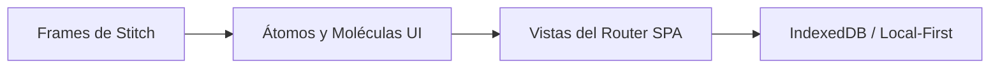

# Arquitectura del Sistema - OficiosVecinos

> **Lectura rápida**: ~1.5 min. Define el stack, router SPA y la integración con Frames de Stitch.

---

## 1. Stack Tecnológico

| Capa | Tecnología | Justificación de Producto |
| :--- | :--- | :--- |
| **Arquitectura** | SPA (Single Page Application) | Cargas instantáneas y navegación fluida tipo app nativa. |
| **Bundler & Core** | Vite + TypeScript (Strict) | Mínimo peso en bytes para datos móviles y tipado sin `any`. |
| **Marcado** | HTML5 Semántico | `header`, `nav`, `main`, `section`, `article`, `footer`, `form`. |
| **Estilos** | Tailwind CSS | Sistema de tokens utilitarios sin CSS redundante. |
| **Persistencia** | IndexedDB + LocalStorage | Local-first: datos offline (IndexedDB) y preferencias (LocalStorage). |

---

## 2. Router SPA Ligero

La aplicación utiliza un enrutador SPA del lado del cliente (hash o history routing) diseñado para celulares de gama baja:
- **Transiciones sin recarga**: Cambio de pantallas instantáneo manteniendo estado en memoria e IndexedDB.
- **Rutas Principales (según Card Sorting)**:
  - `/`: Página Principal (Servicios Populares / Sugerencias Barriales).
  - `/servicios`: Búsqueda por categoría y filtrado por barrio.
  - `/perfil`: Solicitudes, historial, chat y toggle de escala accesible.
  - `/crear-servicio`: Flujo para prestadores (publicación simplificada).
  - `/chat/:id`: Mensajería directa entre vecino y oficio.

---

## 3. Relación con Frames de Stitch (Wireframes Próximos)

El proyecto está estructurado mediante **Diseño Atómico** para mapear directamente los Frames de Stitch una vez sean provistos:

- **Mapeo 1:1**: Cada pantalla diseñada en Stitch se traduce en una vista del router SPA compuesta por componentes atómicos reutilizables (`Button`, `Input`, `ProfessionalCard`, `CategoryGallery`).
- **Conexión Futura**: Cuando el usuario entregue los wireframes/frames de Stitch, se extraerán tokens, layout exacto y microinteracciones para volcar en `DESIGN.md` y en las vistas de `src/views/`.

---

## 4. Estrategia Offline y Baja Conectividad
- **Manejo de red**: Chequeo de `navigator.onLine` con retroalimentación empática.
- **Almacenamiento local**: Datos clave (teléfonos de urgencia ya cargados y borradores de servicios) disponibles 100% sin conexión.
